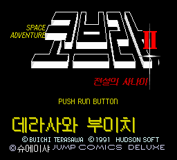
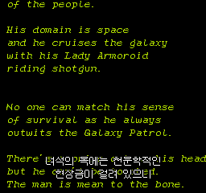
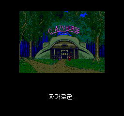
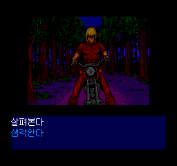
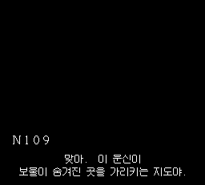
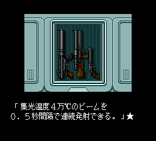
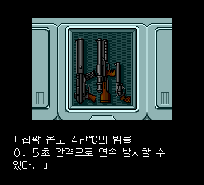
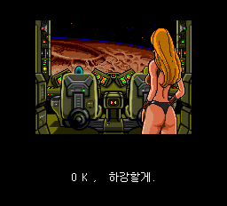
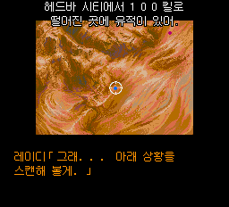

# 실제 게임 스크린샷

v0.81 신규 화면 3장과 v0.8의 수정 전 라이플 화면을 추가했습니다. 기존 타이틀·오프닝·술집·선택지·숨김 음원 검수 5장은 촬영 당시 v0.8 해시를 유지합니다. 모든 PNG는 합성하지 않은 실제 에뮬레이터 캡처이며 빌드별 SHA는 manifest.json에 기록했습니다.

### 한글 타이틀 · Mednafen · 원래 타이틀에서 캡처

### 오프닝 자막 · RetroArch / Beetle PCE FAST · 새 게임

### 술집 건물 앞 첫 자막 · RetroArch / Beetle PCE FAST · 새 게임

### 초반 조사·이동 선택지 · RetroArch / Beetle PCE FAST · 새 게임

### 문신 대사 수정 자막 · 원래 숨김 음원 메뉴에서 재생한 검수 화면

### v0.8 수정 전: 레이저 라이플 설명이 일본어로 남아 있음

### v0.81: 시드 착륙 후 총기 보기 → 레이저 라이플 설명

### v0.81: OK, 하강할게. 실제 정상 LOAD4 진행

### v0.81: 착륙 안내를 위로 옮겨 원래 노란 설명문과 겹침 해소

